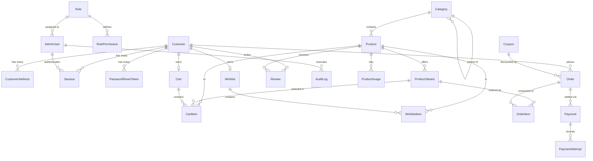

# MELLOSOFT — POSTGRESQL DATABASE DESIGN & PERSISTENCE SPECIFICATION
**Architecture:** PostgreSQL 16+ via Prisma ORM  
**Target Environment:** Hostinger KVM 1 VPS (Ubuntu 24.04 LTS)  
**Schema Version:** 1.0.0  
**Currency Convention:** Integer minor units (or exact Indian Rupees integer) to guarantee zero floating-point rounding errors.

---

## 1. Entity-Relationship Overview



---

## 2. Table Specifications & Schema Definitions

### 2.1 Customer & Identity (`Customer`, `CustomerAddress`, `Session`, `PasswordResetToken`)

#### `Customer`
Stores registered e-commerce shoppers.
- `id` (VARCHAR(36), PK): UUID or cuid.
- `customerId` (VARCHAR(32), UNIQUE, INDEX): Human-readable public ID (e.g., `CUS-0001`).
- `name` (VARCHAR(150), NOT NULL): Customer full name.
- `email` (VARCHAR(255), UNIQUE, INDEX, NOT NULL): Normalized, lowercase email.
- `phone` (VARCHAR(30)): Formatted telephone/mobile.
- `passwordHash` (VARCHAR(255), NOT NULL): Argon2id / bcrypt salted hash. Plaintext passwords strictly prohibited.
- `status` (VARCHAR(20), DEFAULT 'Active'): `'Active'`, `'Suspended'`, `'Pending'`.
- `avatar` (VARCHAR(255)): URL or single avatar character.
- `lastLogin` (TIMESTAMP WITH TIME ZONE): Updated on successful login.
- `createdAt` (TIMESTAMP WITH TIME ZONE, DEFAULT NOW()).
- `updatedAt` (TIMESTAMP WITH TIME ZONE, DEFAULT NOW()).

#### `CustomerAddress`
Normalized customer delivery and billing addresses.
- `id` (VARCHAR(36), PK): UUID.
- `customerId` (VARCHAR(36), FK -> `Customer.id`, INDEX, NOT NULL, ON DELETE CASCADE).
- `label` (VARCHAR(50), DEFAULT 'Home'): E.g., 'Home', 'Work', 'Other'.
- `fullName` (VARCHAR(150), NOT NULL).
- `phone` (VARCHAR(30), NOT NULL).
- `addressLine1` (VARCHAR(255), NOT NULL).
- `addressLine2` (VARCHAR(255)).
- `landmark` (VARCHAR(150)).
- `city` (VARCHAR(100), NOT NULL).
- `state` (VARCHAR(100), NOT NULL).
- `postalCode` (VARCHAR(20), NOT NULL).
- `country` (VARCHAR(100), DEFAULT 'India').
- `isDefault` (BOOLEAN, DEFAULT FALSE).
- `createdAt` (TIMESTAMP WITH TIME ZONE, DEFAULT NOW()).
- `updatedAt` (TIMESTAMP WITH TIME ZONE, DEFAULT NOW()).

#### `Session`
Server-managed session store with opaque, cryptographically random identifiers.
- `id` (VARCHAR(36), PK): UUID.
- `token` (VARCHAR(128), UNIQUE, INDEX, NOT NULL): 64-byte CSPRNG hex string.
- `customerId` (VARCHAR(36), FK -> `Customer.id`, ON DELETE CASCADE).
- `adminUserId` (VARCHAR(36), FK -> `AdminUser.id`, ON DELETE CASCADE).
- `ipAddress` (VARCHAR(45)).
- `userAgent` (TEXT).
- `expiresAt` (TIMESTAMP WITH TIME ZONE, NOT NULL, INDEX).
- `createdAt` (TIMESTAMP WITH TIME ZONE, DEFAULT NOW()).

#### `PasswordResetToken`
One-time cryptographically secure tokens for password recovery.
- `id` (VARCHAR(36), PK).
- `token` (VARCHAR(128), UNIQUE, INDEX, NOT NULL): CSPRNG hash.
- `customerId` (VARCHAR(36), FK -> `Customer.id`, ON DELETE CASCADE).
- `adminUserId` (VARCHAR(36), FK -> `AdminUser.id`, ON DELETE CASCADE).
- `expiresAt` (TIMESTAMP WITH TIME ZONE, NOT NULL).
- `usedAt` (TIMESTAMP WITH TIME ZONE).
- `createdAt` (TIMESTAMP WITH TIME ZONE, DEFAULT NOW()).

---

### 2.2 Roles, Permissions & Administration (`Role`, `RolePermission`, `AdminUser`, `AuditLog`)

#### `Role`
Granular system and custom back-office roles.
- `id` (VARCHAR(50), PK): E.g., `'role-super-admin'`, `'role-admin'`, `'role-manager'`, `'role-staff'`.
- `name` (VARCHAR(100), UNIQUE, NOT NULL).
- `description` (TEXT).
- `isSystemRole` (BOOLEAN, DEFAULT FALSE): System default roles cannot be deleted or demoted.
- `createdAt` (TIMESTAMP WITH TIME ZONE, DEFAULT NOW()).
- `updatedAt` (TIMESTAMP WITH TIME ZONE, DEFAULT NOW()).

#### `RolePermission`
Normalized matrix mapping roles to module actions.
- `id` (VARCHAR(36), PK).
- `roleId` (VARCHAR(50), FK -> `Role.id`, ON DELETE CASCADE, NOT NULL).
- `module` (VARCHAR(50), NOT NULL): `'dashboard'`, `'products'`, `'orders'`, `'customers'`, `'reviews'`, `'content'`, `'users'`, `'roles'`, `'settings'`.
- `action` (VARCHAR(50), NOT NULL): `'view'`, `'create'`, `'edit'`, `'delete'`, `'approve'`, `'reject'`, `'moderate'`, `'updateStatus'`, `'featureOnHome'`.
- **Constraint:** UNIQUE(`roleId`, `module`, `action`).

#### `AdminUser`
Administrative operator registry.
- `id` (VARCHAR(36), PK): E.g., `'user-001'`.
- `name` (VARCHAR(150), NOT NULL).
- `email` (VARCHAR(255), UNIQUE, INDEX, NOT NULL).
- `phone` (VARCHAR(30)).
- `passwordHash` (VARCHAR(255), NOT NULL): Salted Argon2id / bcrypt hash.
- `roleId` (VARCHAR(50), FK -> `Role.id`, NOT NULL).
- `status` (VARCHAR(20), DEFAULT 'Active'): `'Active'`, `'Inactive'`.
- `lastLogin` (TIMESTAMP WITH TIME ZONE).
- `createdAt` (TIMESTAMP WITH TIME ZONE, DEFAULT NOW()).
- `updatedAt` (TIMESTAMP WITH TIME ZONE, DEFAULT NOW()).

#### `AuditLog`
Immutable administrative audit trail.
- `id` (VARCHAR(36), PK).
- `adminUserId` (VARCHAR(36), FK -> `AdminUser.id`, ON DELETE SET NULL).
- `action` (VARCHAR(100), NOT NULL): E.g., `'UPDATE_ORDER_STATUS'`, `'DELETE_PRODUCT'`.
- `resource` (VARCHAR(50), NOT NULL): E.g., `'orders'`, `'products'`.
- `resourceId` (VARCHAR(100)): ID of affected entity.
- `details` (JSONB): Old values, new values, reason.
- `ipAddress` (VARCHAR(45)).
- `createdAt` (TIMESTAMP WITH TIME ZONE, DEFAULT NOW(), INDEX).

---

### 2.3 Product Catalog, Categories & Variants (`Category`, `Product`, `ProductImage`, `ProductVariant`)

#### `Category`
Hierarchical catalog classification.
- `id` (VARCHAR(50), PK): E.g., `'CAT-MATTRESSES'`, `'SUB-FOAM'`.
- `slug` (VARCHAR(100), UNIQUE, INDEX, NOT NULL): E.g., `'mattresses'`, `'foam'`.
- `name` (VARCHAR(150), NOT NULL).
- `parentId` (VARCHAR(50), FK -> `Category.id`, ON DELETE SET NULL): Self-referencing parent.
- `isParent` (BOOLEAN, DEFAULT FALSE).
- `type` (VARCHAR(50), DEFAULT 'main'): `'main'`, `'subcategory'`.
- `showInNavigation` (BOOLEAN, DEFAULT TRUE).
- `active` (BOOLEAN, DEFAULT TRUE).
- `order` (INTEGER, DEFAULT 0).
- `image` (VARCHAR(500)).
- `description` (TEXT).
- `aliases` (JSONB): Alternate slugs for discovery (`['foam', 'foam-mattress']`).
- `createdAt` (TIMESTAMP WITH TIME ZONE, DEFAULT NOW()).
- `updatedAt` (TIMESTAMP WITH TIME ZONE, DEFAULT NOW()).

#### `Product`
Master catalog item record.
- `id` (VARCHAR(100), PK): URL slug, e.g., `'classic-mattress'`, `'haven'`.
- `productId` (VARCHAR(50), UNIQUE, INDEX, NOT NULL): E.g., `'PROD-HAVEN'`.
- `name` (VARCHAR(200), NOT NULL).
- `tagline` (TEXT).
- `description` (TEXT).
- `specs` (TEXT).
- `categoryId` (VARCHAR(50), FK -> `Category.id`, NOT NULL).
- `categorySlug` (VARCHAR(100), NOT NULL).
- `parentCategorySlug` (VARCHAR(100)).
- `badge` (VARCHAR(50)): E.g., `'Bestseller'`, `'New'`.
- `price` (INTEGER, NOT NULL): Base starting display price in Rupees.
- `actualPrice` (INTEGER, NOT NULL): Pre-discount price.
- `discountPercent` (INTEGER, DEFAULT 0).
- `rating` (DECIMAL(3, 2), DEFAULT 0.00).
- `reviewCount` (INTEGER, DEFAULT 0).
- `active` (BOOLEAN, DEFAULT TRUE, INDEX).
- `isFeatured` (BOOLEAN, DEFAULT FALSE).
- `isNewArrival` (BOOLEAN, DEFAULT FALSE).
- `newArrivalOrder` (INTEGER, DEFAULT 999).
- `isBestSeller` (BOOLEAN, DEFAULT FALSE).
- `construction` (VARCHAR(150)).
- `thicknessOptions` (JSONB): `['4 inch', '5 inch', '6 inch', '8 inch']`.
- `sizeOptions` (JSONB): `['Single', 'Double', 'Queen', 'King']`.
- `dimensions` (JSONB): All supported dimensional combinations.
- `features` (JSONB): Highlight bullet points.
- `deliveryPerks` (JSONB): Guarantee & shipping policies.
- `createdAt` (TIMESTAMP WITH TIME ZONE, DEFAULT NOW()).
- `updatedAt` (TIMESTAMP WITH TIME ZONE, DEFAULT NOW()).

#### `ProductImage`
Persistent image references.
- `id` (VARCHAR(36), PK).
- `productId` (VARCHAR(100), FK -> `Product.id`, ON DELETE CASCADE, NOT NULL).
- `url` (VARCHAR(500), NOT NULL): Public server path or static URL.
- `alt` (VARCHAR(200)).
- `displayOrder` (INTEGER, DEFAULT 0).
- `isPrimary` (BOOLEAN, DEFAULT FALSE).

#### `ProductVariant`
Authoritative stock and price for every size/firmness/thickness permutation.
- `id` (VARCHAR(100), PK): E.g., `'VAR-HAVEN-4IN-72X30'`.
- `sku` (VARCHAR(100), UNIQUE, INDEX, NOT NULL): E.g., `'MEL-HAVEN-4IN-7230'`.
- `productId` (VARCHAR(100), FK -> `Product.id`, ON DELETE CASCADE, NOT NULL).
- `size` (VARCHAR(50)): `'Single'`, `'Double'`, `'Queen'`, `'King'`.
- `dimension` (VARCHAR(50)): `'72 x 30'`, `'78 x 60'`.
- `thickness` (VARCHAR(50)): `'4 inch'`, `'5 inch'`, etc.
- `firmness` (VARCHAR(50)): `'Soft'`, `'Medium'`, `'Firm'`.
- `actualPrice` (INTEGER, NOT NULL): Authoritative pre-discount price.
- `discountPercent` (INTEGER, DEFAULT 0).
- `discountedPrice` (INTEGER, NOT NULL): Computed on server.
- `stock` (INTEGER, DEFAULT 10): Authoritative available inventory count.
- `threshold` (INTEGER, DEFAULT 2): Low stock notification boundary.
- `status` (VARCHAR(20), DEFAULT 'Active'): `'Active'`, `'Discontinued'`.
- `createdAt` (TIMESTAMP WITH TIME ZONE, DEFAULT NOW()).
- `updatedAt` (TIMESTAMP WITH TIME ZONE, DEFAULT NOW()).

---

### 2.4 Shopping Cart & Wishlist (`Cart`, `CartItem`, `Wishlist`, `WishlistItem`)

#### `Cart`
Shopping session container for both authenticated shoppers and guests.
- `id` (VARCHAR(36), PK).
- `customerId` (VARCHAR(36), UNIQUE, FK -> `Customer.id`, ON DELETE CASCADE): Nullable for guests.
- `guestSessionToken` (VARCHAR(128), UNIQUE, INDEX): For unauthenticated visitors.
- `createdAt` (TIMESTAMP WITH TIME ZONE, DEFAULT NOW()).
- `updatedAt` (TIMESTAMP WITH TIME ZONE, DEFAULT NOW()).

#### `CartItem`
Cart line entries.
- `id` (VARCHAR(100), PK).
- `cartId` (VARCHAR(36), FK -> `Cart.id`, ON DELETE CASCADE, NOT NULL).
- `productId` (VARCHAR(100), FK -> `Product.id`, NOT NULL).
- `variantId` (VARCHAR(100), FK -> `ProductVariant.id`): Resolved variant.
- `size` (VARCHAR(50)).
- `firmness` (VARCHAR(50)).
- `dimension` (VARCHAR(50)).
- `thickness` (VARCHAR(50)).
- `sku` (VARCHAR(100)).
- `quantity` (INTEGER, DEFAULT 1, NOT NULL).
- `addedAt` (TIMESTAMP WITH TIME ZONE, DEFAULT NOW()).
- **Constraint:** UNIQUE(`cartId`, `productId`, `size`, `firmness`, `dimension`, `thickness`).

#### `Wishlist` & `WishlistItem`
Persistent customer favorites.
- `Wishlist`: `id`, `customerId` (UNIQUE, FK -> `Customer.id`, ON DELETE CASCADE).
- `WishlistItem`: `id`, `wishlistId` (FK), `productId` (FK -> `Product.id`), `addedAt`. UNIQUE(`wishlistId`, `productId`).

---

### 2.5 Orders, Payments & Fulfillment (`Order`, `OrderItem`, `Payment`, `PaymentAttempt`)

#### `Order`
Authoritative order record with immutable historical address and pricing snapshots.
- `id` (VARCHAR(50), PK): E.g., `'MS-94812'`.
- `orderNumber` (VARCHAR(50), UNIQUE, INDEX, NOT NULL).
- `customerId` (VARCHAR(36), FK -> `Customer.id`, ON DELETE SET NULL, INDEX): Nullable for guest checkouts.
- `customerName` (VARCHAR(150), NOT NULL).
- `email` (VARCHAR(255), NOT NULL, INDEX).
- `phone` (VARCHAR(30), NOT NULL).
- `shippingAddress` (JSONB, NOT NULL): Immutable snapshot of recipient, street, city, pin, phone.
- `paymentMethod` (VARCHAR(50), NOT NULL): `'COD'`, `'UPI'`, `'RAZORPAY'`, `'STRIPE'`.
- `paymentStatus` (VARCHAR(30), DEFAULT 'Pending', INDEX): `'Pending'`, `'Paid'`, `'Failed'`, `'Refunded'`.
- `orderStatus` (VARCHAR(30), DEFAULT 'Pending', INDEX): `'Pending'`, `'Confirmed'`, `'Processing'`, `'Shipped'`, `'Delivered'`, `'Cancelled'`.
- `subtotal` (INTEGER, NOT NULL): Sum of line items.
- `discountAmount` (INTEGER, DEFAULT 0).
- `couponCode` (VARCHAR(50)).
- `couponDiscount` (INTEGER, DEFAULT 0).
- `taxAmount` (INTEGER, NOT NULL): GST amount (18%).
- `shippingAmount` (INTEGER, DEFAULT 0).
- `totalAmount` (INTEGER, NOT NULL): Grand total payable.
- `currency` (VARCHAR(10), DEFAULT 'INR').
- `notes` (TEXT).
- `expectedDeliveryStart` (DATE).
- `expectedDeliveryEnd` (DATE).
- `createdAt` (TIMESTAMP WITH TIME ZONE, DEFAULT NOW(), INDEX).
- `updatedAt` (TIMESTAMP WITH TIME ZONE, DEFAULT NOW()).

#### `OrderItem`
Immutable line-item snapshot preserving catalog details at time of purchase.
- `id` (VARCHAR(36), PK).
- `orderId` (VARCHAR(50), FK -> `Order.id`, ON DELETE CASCADE, NOT NULL, INDEX).
- `productId` (VARCHAR(100), NOT NULL): Historical reference.
- `variantId` (VARCHAR(100)): Historical reference.
- `productName` (VARCHAR(200), NOT NULL): Preserved title.
- `sku` (VARCHAR(100), NOT NULL): Preserved SKU.
- `size` (VARCHAR(50)).
- `firmness` (VARCHAR(50)).
- `dimension` (VARCHAR(50)).
- `thickness` (VARCHAR(50)).
- `quantity` (INTEGER, NOT NULL).
- `price` (INTEGER, NOT NULL): Authoritative discounted unit price charged.
- `actualPrice` (INTEGER, NOT NULL): Catalog list price at time of sale.
- `discountPercent` (INTEGER, DEFAULT 0).
- `image` (VARCHAR(500)): Preserved primary product image URL.
- `total` (INTEGER, NOT NULL): `price * quantity`.

#### `Payment`
Payment transaction lifecycle tracking.
- `id` (VARCHAR(36), PK).
- `orderId` (VARCHAR(50), FK -> `Order.id`, ON DELETE CASCADE, NOT NULL, INDEX).
- `provider` (VARCHAR(50), NOT NULL): `'COD'`, `'RAZORPAY'`, `'STRIPE'`.
- `providerOrderId` (VARCHAR(100), INDEX): Gateway order reference ID.
- `providerPaymentId` (VARCHAR(100), INDEX): Gateway payment reference ID.
- `providerSignature` (VARCHAR(255)): HMAC signature for verification.
- `amount` (INTEGER, NOT NULL).
- `currency` (VARCHAR(10), DEFAULT 'INR').
- `status` (VARCHAR(30), NOT NULL): `'Pending'`, `'Successful'`, `'Failed'`, `'Refunded'`.
- `rawResponse` (JSONB): Complete gateway response metadata.
- `createdAt` (TIMESTAMP WITH TIME ZONE, DEFAULT NOW()).
- `updatedAt` (TIMESTAMP WITH TIME ZONE, DEFAULT NOW()).

#### `PaymentAttempt`
Idempotent webhook & transaction event log.
- `id` (VARCHAR(36), PK).
- `paymentId` (VARCHAR(36), FK -> `Payment.id`, ON DELETE CASCADE, NOT NULL).
- `event` (VARCHAR(100), NOT NULL): E.g., `'payment.authorized'`, `'payment.captured'`.
- `status` (VARCHAR(30), NOT NULL).
- `payload` (JSONB): Raw event payload.
- `createdAt` (TIMESTAMP WITH TIME ZONE, DEFAULT NOW()).

---

### 2.6 Reviews, Coupons, Banners & Settings (`Review`, `Coupon`, `Banner`, `ApplicationSettings`)

#### `Review`
Customer ratings and reviews with moderation.
- `id` (VARCHAR(36), PK).
- `productId` (VARCHAR(100), FK -> `Product.id`, ON DELETE CASCADE, NOT NULL, INDEX).
- `customerId` (VARCHAR(36), FK -> `Customer.id`, ON DELETE SET NULL).
- `customerName` (VARCHAR(150), NOT NULL).
- `rating` (INTEGER, NOT NULL): 1 to 5 stars.
- `title` (VARCHAR(200)).
- `comment` (TEXT, NOT NULL).
- `status` (VARCHAR(20), DEFAULT 'Pending', INDEX): `'Pending'`, `'Approved'`, `'Rejected'`.
- `showOnHome` (BOOLEAN, DEFAULT FALSE).
- `helpfulCount` (INTEGER, DEFAULT 0).
- `verifiedPurchase` (BOOLEAN, DEFAULT FALSE).
- `images` (JSONB): User-uploaded review photos.
- `createdAt` (TIMESTAMP WITH TIME ZONE, DEFAULT NOW()).
- `updatedAt` (TIMESTAMP WITH TIME ZONE, DEFAULT NOW()).

#### `Coupon`
Promotional codes and discounts.
- `id` (VARCHAR(36), PK).
- `code` (VARCHAR(50), UNIQUE, INDEX, NOT NULL): Uppercase voucher code.
- `discountType` (VARCHAR(20), NOT NULL): `'percentage'`, `'fixed'`, `'shipping'`.
- `discountValue` (INTEGER, NOT NULL): Percentage rate (e.g. 25) or flat amount in INR.
- `minOrderValue` (INTEGER, DEFAULT 0).
- `maxDiscount` (INTEGER): Cap for percentage discounts.
- `usageLimit` (INTEGER, DEFAULT 0): 0 = unlimited.
- `usageCount` (INTEGER, DEFAULT 0).
- `expiryDate` (TIMESTAMP WITH TIME ZONE).
- `status` (VARCHAR(20), DEFAULT 'Active'): `'Active'`, `'Expired'`, `'Disabled'`.
- `createdAt` (TIMESTAMP WITH TIME ZONE, DEFAULT NOW()).
- `updatedAt` (TIMESTAMP WITH TIME ZONE, DEFAULT NOW()).

#### `Banner`
Homepage hero slides and promotional banners.
- `id` (VARCHAR(50), PK).
- `title` (VARCHAR(200), NOT NULL).
- `subtitle` (VARCHAR(200)).
- `description` (TEXT).
- `type` (VARCHAR(50), DEFAULT 'Offer'): `'Offer'`, `'Sale'`, `'Announcement'`.
- `image` (VARCHAR(500), NOT NULL).
- `ctaText` (VARCHAR(50)).
- `ctaLink` (VARCHAR(200)).
- `productId` (VARCHAR(100)): Target product.
- `isActive` (BOOLEAN, DEFAULT TRUE).
- `displayOrder` (INTEGER, DEFAULT 1).
- `createdAt` (TIMESTAMP WITH TIME ZONE, DEFAULT NOW()).
- `updatedAt` (TIMESTAMP WITH TIME ZONE, DEFAULT NOW()).

#### `ApplicationSettings`
Persistent global store configuration.
- `id` (VARCHAR(50), PK, DEFAULT 'global_settings').
- `data` (JSONB, NOT NULL): Stores JSON configuration for:
  - `store`: Name, email, phone, GSTIN, address.
  - `shipping`: Free shipping threshold (default ₹5,000), standard fee (default ₹499).
  - `taxes`: Default GST rate (18%).
  - `payments`: Enabled methods (COD, UPI, Razorpay, Stripe).
  - `website`: Logo, favicon, maintenance mode.
- `updatedAt` (TIMESTAMP WITH TIME ZONE, DEFAULT NOW()).

---

## 3. Migration & Seeding Strategy

### Migration Commands
```bash
# Generate Prisma Client
npx prisma generate

# Apply pending migrations to PostgreSQL database
npx prisma migrate deploy

# Development migration creation
npx prisma migrate dev --name init_schema
```

### Seeding Workflow
1. `seed.js` checks if database already contains records (idempotent guard).
2. Seeds Default System Roles (`Super Admin`, `Admin`, `Manager`, `Staff`) with comprehensive permission matrices.
3. Seeds Default Super Admin account using operator-specified password or secure environment variable `BOOTSTRAP_ADMIN_PASSWORD` (no default hardcoded password in production).
4. Seeds 3 Master Categories (`Mattresses`, `Accessories`, `Bed Frames`) and 14 subcategories.
5. Migrates all 60 master products from `mattressData.js` and `products.js` with full matrix pricing, size options, and variants.
6. Seeds standard promotional banners, default store settings, and active discount coupons (`SUMMER30`, `DIWALI25`, `FREESHIP`).
